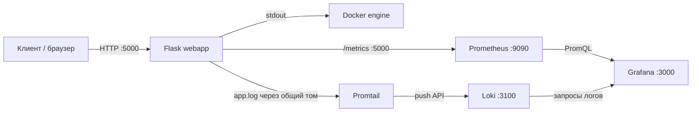

# Учебный стенд: веб-сервис и наблюдаемость

Небольшое Flask-приложение и локальный стек для практики Docker Compose, метрик и логов. Grafana автоматически загружает дашборд приложения с панелями Prometheus и Loki.

## Архитектура

## Компоненты

| Компонент | Назначение | Порт на хосте |
| --- | --- | ---: |
| `webapp` | Flask API: `/`, `/health`, `/metrics`, `/demo-error` | 5000 |
| `prometheus` | Сбор метрик приложения с интервалом 15 секунд | 9090 |
| `grafana` | Интерфейс для просмотра метрик и логов; источники данных задаются через provisioning | 3000 |
| `loki` | Приём и хранение логов | 3100 |
| `promtail` | Читает `/var/log/app/app.log` из общего тома и отправляет логи в Loki | — |

Все сервисы запускаются через `docker-compose.yml`. Внутри Compose-сети Prometheus обращается к приложению по имени `webapp`, Promtail отправляет логи в `http://loki:3100`, а Grafana подключается к Prometheus и Loki по именам сервисов.

## Потоки данных

### HTTP и метрики

1. Клиент отправляет HTTP-запрос приложению на порт `5000`.
2. Приложение отвечает на `/`, `/health` и `/metrics`.
3. Prometheus периодически запрашивает `http://webapp:5000/metrics` согласно `prometheus.yml`.
4. Grafana предназначена для просмотра данных Prometheus.

Flask middleware увеличивает счётчик `http_requests_total` и записывает длительность запросов в `http_request_duration_seconds`. Метрики с `/metrics` исключены из подсчёта, чтобы Prometheus не учитывался как пользовательский трафик.

### Логи

Приложение пишет логи в stdout и дублирует их в ротируемый файл `/var/log/app/app.log`. Этот каталог находится в общем Compose-томе: приложение пишет в него, а Promtail подключает том только для чтения и отправляет записи в Loki. Docker socket агенту не нужен. Ротация файла ограничена пятью мегабайтами и тремя резервными файлами.

## Известные ограничения и следующие шаги

- Нет health checks контейнеров; `depends_on` не гарантирует готовность зависимого сервиса.
- Для Prometheus, Grafana и Loki указаны плавающие теги `latest`.
- Пароль Grafana `admin` задан прямо в Compose.
- Источники Prometheus и Loki, а также дашборд приложения автоматически настраиваются в Grafana.
- Приложение запущено встроенным сервером Flask и работает от пользователя root контейнера.
- Нет CI pipeline и алертов; health checks контейнеров не настроены.
- Для учебного стенда задан простой пароль Grafana `admin`; перед публикацией проекта следует вынести его в переменную окружения и добавить `.env.example` без секретов.

Проверено вручную: Promtail читает файл приложения из общего тома, а записи приложения доступны в Loki через Grafana Explore. Дашборд хранится в `grafana/dashboards/server-devops-overview.json` и загружается через provisioning.

## Дашборд Grafana

Дашборд **Server DevOps — приложение** содержит частоту запросов по маршруту, частоту ответов 5xx и логи приложения с путями запросов и текстами событий. Учебный маршрут `/demo-error` возвращает 500, чтобы можно было наполнить панель ошибок.

## Запуск

Запустите стек командой `docker compose up -d --build`. Grafana доступна на `http://localhost:3000` (учётные данные стенда: `admin` / `admin`), приложение — на `http://localhost:5000`.

Для заполнения панелей дашборда отправьте запросы к `/` и `/health`. Маршрут `/demo-error` предназначен для проверки учёта ответов 500. Prometheus опрашивает приложение каждые 15 секунд, поэтому после первых запросов дайте ему время собрать несколько точек.

Остановить сервисы можно командой `docker compose down`. Именованные тома при этом сохраняются; `docker compose down -v` удалит в том числе сохранённые данные Grafana и логи приложения.
