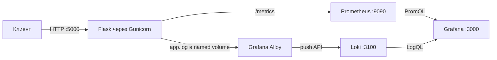

# Учебный стенд: приложение и наблюдаемость

Flask-приложение под Gunicorn в Docker Compose со сбором метрик через Prometheus, логов через Grafana Alloy и Loki и дашбордом Grafana. GitHub Actions запускает тесты, проверяет Compose-конфигурацию и собирает образ приложения. Стенд предназначен для локального обучения.

## Архитектура



## Сервисы и адреса

| Сервис | Назначение | Адрес на хосте |
| --- | --- | --- |
| `webapp` | Flask API под Gunicorn | `http://localhost:5000` |
| `prometheus` | Сбор метрик каждые 15 секунд и оценка правил алертов | `http://localhost:9090` |
| `grafana` | Дашборд метрик и логов | `http://localhost:3000` |
| `loki` | Хранение логов | `http://localhost:3100` |
| `alloy` | Чтение файла логов и отправка в Loki | внутренний сервис |

Внутри сети Compose сервисы обращаются друг к другу по именам. Alloy читает общий том `app-logs` только для чтения; Docker socket не используется. Позиция чтения Alloy сохраняется в томе `alloy-data`. Приложение работает не от root, а init-сервис перед его запуском настраивает владельца общего тома логов. Grafana provisioning автоматически настраивает источники Prometheus и Loki и загружает дашборд **Server DevOps — приложение**. Версии образов Prometheus, Grafana, Loki и Alloy закреплены в Compose.

## Запуск

Создайте локальный файл с паролем Grafana и замените примерное значение на своё:

```bash
cp .env.example .env
chmod 600 .env
```

Замените примерный пароль в `.env`, затем запустите стенд:

```bash
docker compose up -d --build --remove-orphans
docker compose ps
```

Grafana использует логин `admin` и пароль из `.env`. Файл `.env` исключён из Git; в репозитории хранится только шаблон `.env.example`.

Остановить сервисы можно командой `docker compose down`. Именованные тома сохраняются. Команда `docker compose down -v` удалит данные Grafana, логи приложения и позицию чтения Alloy.

## Эндпоинты приложения

| Путь | Назначение |
| --- | --- |
| `/` | Демонстрационный успешный запрос |
| `/health` | Health check контейнера |
| `/metrics` | Метрики Prometheus; сам скрейп не учитывается как пользовательский запрос |
| `/demo-error` | Учебный ответ HTTP 500 для панели ошибок |

Проверка health check:

```bash
docker compose ps
```

После запуска состояние `webapp` должно стать `healthy`. Prometheus запускается после того, как приложение прошло проверку готовности.

## Метрики и логи

Приложение выставляет `http_requests_total` с метками метода, маршрута и HTTP-статуса, а также `http_request_duration_seconds`. Метрики `/metrics` исключены из пользовательского счётчика. Неизвестные маршруты используют общее значение `unmatched` в метке маршрута, чтобы случайные URL не создавали бесконечное число временных рядов.

Приложение пишет события и сведения о запросе (метод, путь, статус и длительность) в stdout и ротируемый `/var/log/app/app.log`. Alloy отправляет файл в Loki с метками `job="flask"` и `service="webapp"`. Для создания данных на дашборде обращайтесь к `/` и `/health`; `/demo-error` создаёт ответ 500. Дайте Prometheus время собрать несколько точек.

## Проверки и CI

Локально тесты можно запустить из корня репозитория:

```bash
python3 -m pip install -r app/requirements.txt -r requirements-dev.txt
python3 -m pytest -q
```

Workflow GitHub Actions запускается на `push` в любую ветку и на `pull_request` в `main`. Он устанавливает зависимости, запускает тесты, проверяет Compose-конфигурацию и собирает образ приложения. Публикации образа и автоматического развёртывания нет.

## Алерты и ограничения

Prometheus проверяет два правила: `WebAppTargetDown` срабатывает, если приложение недоступно для скрейпа дольше минуты, а `WebAppHttp5xx` — если за последние пять минут были ответы 5xx. Состояния правил видны на странице `http://localhost:9090/alerts`. Отправка уведомлений не настроена.

`/demo-error` предназначен для демонстрации и локальной проверки метрики ошибок. Стенд рассчитан на локальное обучение и не является production-развёртыванием.
